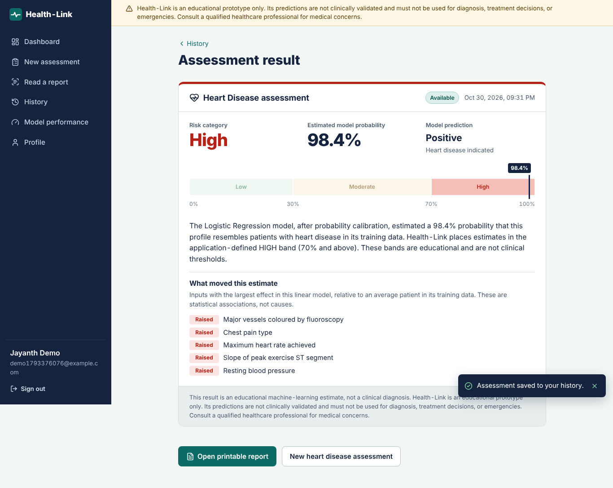
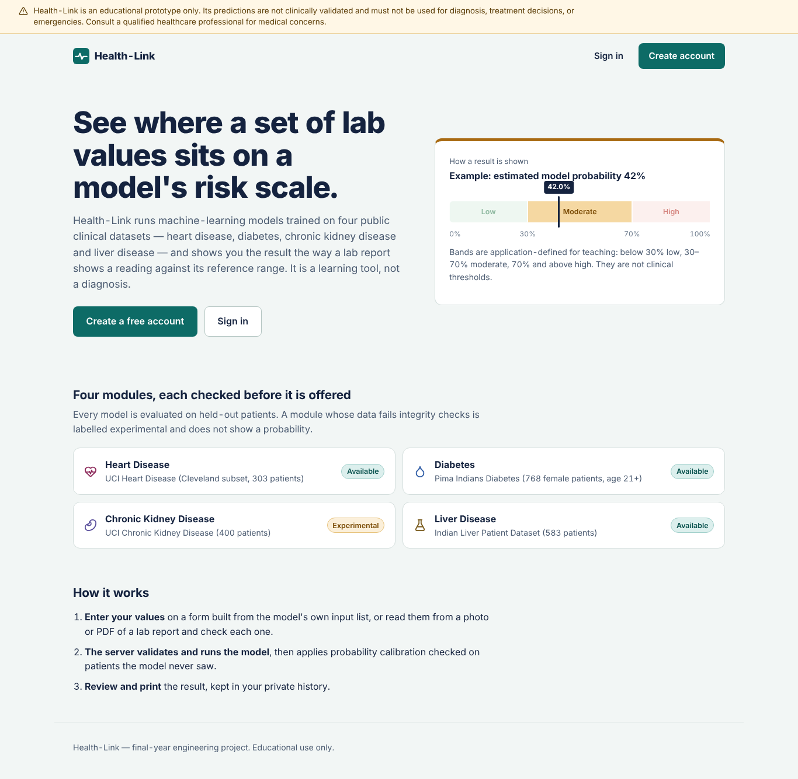
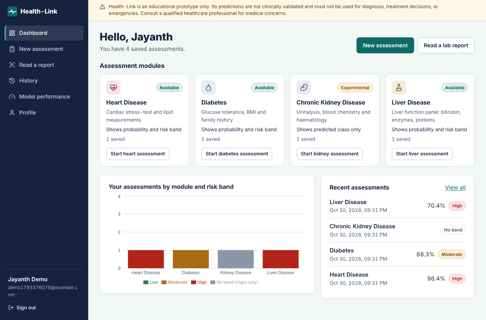
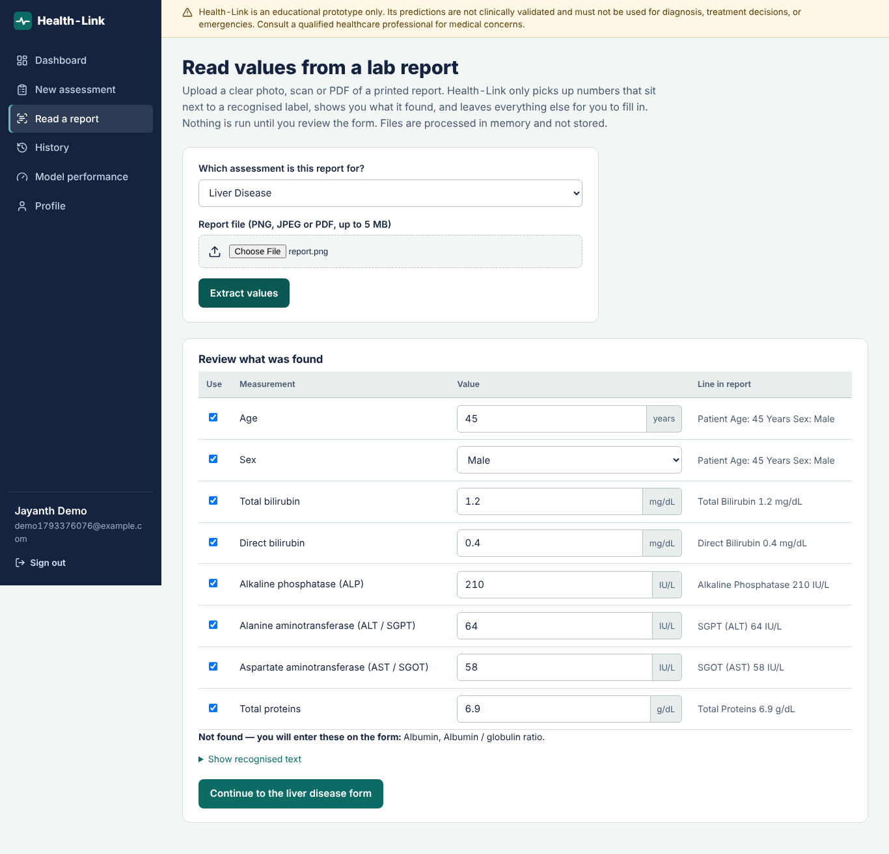
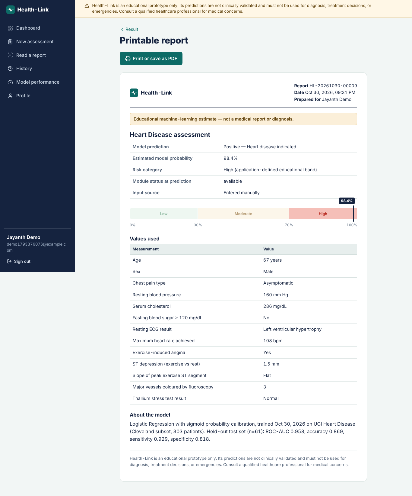
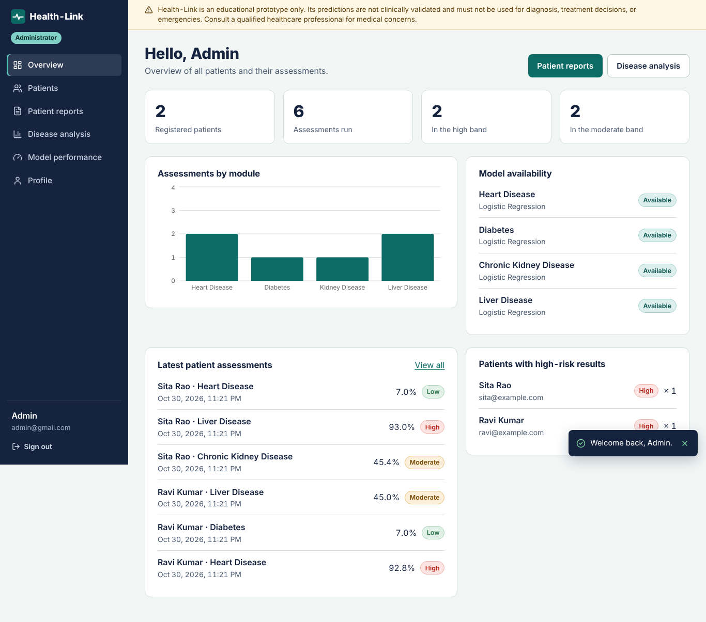
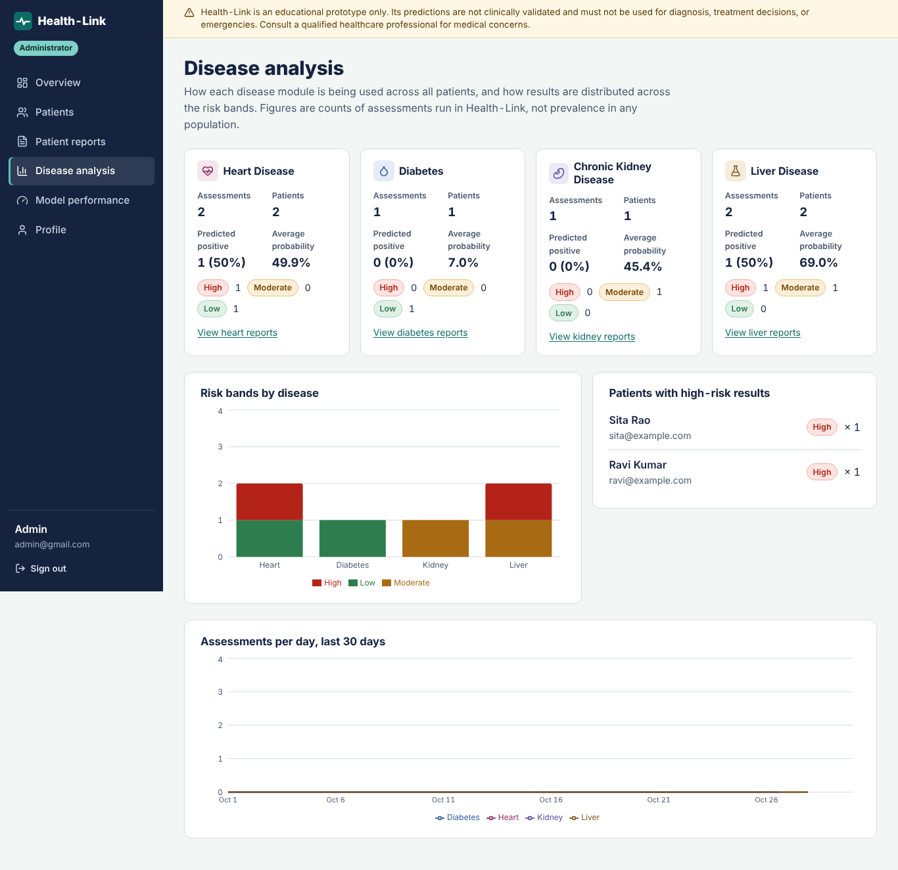
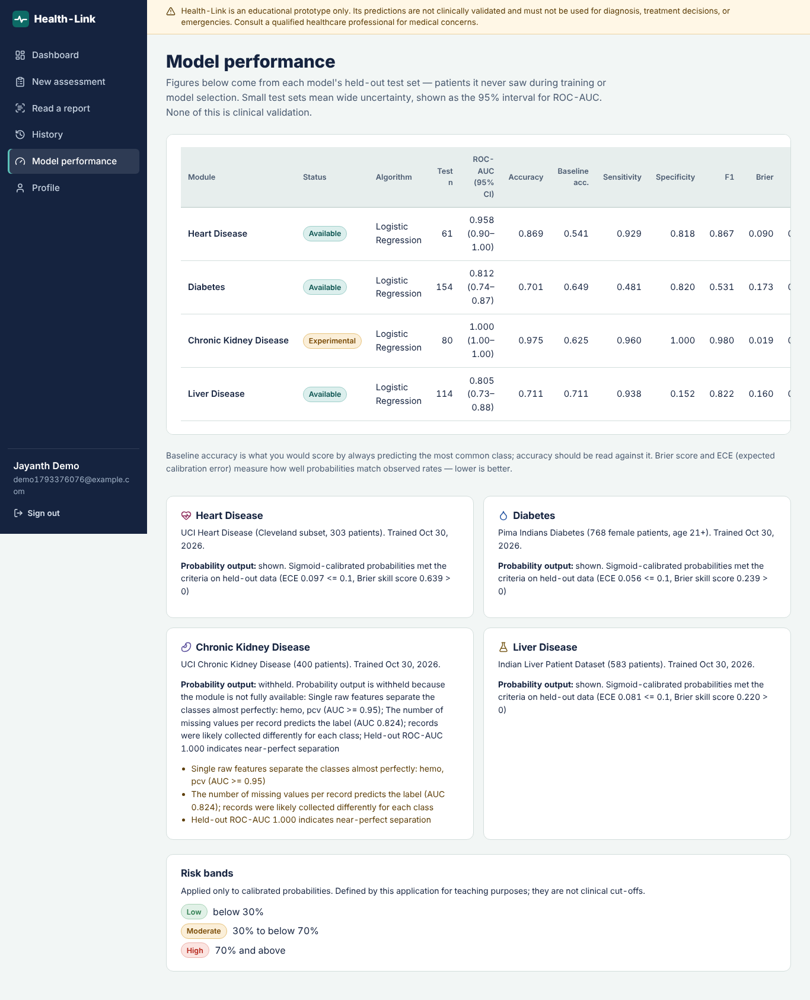
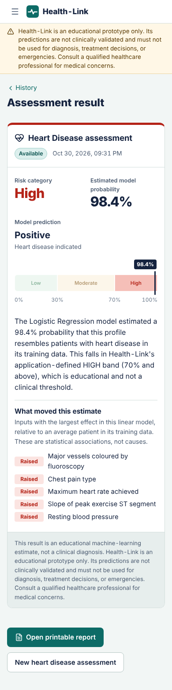

<div align="center">

# Health-Link

### Machine-learning based multi-disease risk assessment platform

**Final Year Major Project · B.Tech / B.E.**

Heart Disease · Diabetes · Chronic Kidney Disease · Liver Disease


</div>

> **Medical disclaimer:** Health-Link is an educational prototype. Its predictions are not clinically validated and must not be used for diagnosis, treatment decisions or emergencies. Anyone with a medical concern should consult a qualified healthcare professional.



---

## Abstract

Chronic diseases such as heart disease, diabetes, chronic kidney disease and liver disease often go unnoticed until late. Routine lab values could flag them earlier, but a single number on a lab sheet is hard for a patient to interpret.

**Health-Link** is a full-stack web application that applies supervised machine-learning models, trained on four public clinical datasets, to a patient's lab values. Its output is a **calibrated probability** and an **educational Low / Moderate / High risk band**. The result is shown the way a lab report shows a reading against its reference range.

Patients can type their values in or **upload a photo or PDF of a lab report**. OCR reads the values, and the patient checks them before anything is predicted. Every result is saved to a private history and can be printed as a report. A separate **administrator console** shows every patient's assessments along with disease-wise analytics.

What sets the project apart is its emphasis on **methodological honesty**:

- Preprocessing is leak-free.
- Models are selected by cross-validation, not by test accuracy.
- Probabilities are calibrated and checked on patients the model never saw.
- Every dataset goes through automated integrity checks, and their caveats are shown in the app itself.

## Problem statement

Machine-learning disease predictors in student and hobby projects commonly suffer from three problems:

- They report inflated accuracy, because preprocessing leaks test data into training.
- They present a class label (“positive”) as if it were a diagnosis.
- They turn a label into an invented “risk percentage”.

Health-Link sets out to build a disease-risk tool that is useful and well engineered and that **never overstates what its models can do**.

## Objectives

1. Build reproducible training pipelines for four diseases on standard public datasets, comparing six algorithms.
2. Produce **calibrated** probabilities and map them to a shared, clearly documented risk scale.
3. Deliver a secure, responsive web application with authentication, history and printable reports.
4. Reduce data-entry effort with **OCR extraction** from lab reports, keeping the user in control of every value.
5. Give administrators a view of all patients' results and disease-level analytics.
6. Back everything with automated tests and documentation.

## Key features

| For patients | For administrators |
|---|---|
| Register and sign in securely | Separate admin console and navigation |
| Four assessment forms generated from each model's input schema | **Overview:** patients, assessments, high-risk counts, latest results |
| Upload a lab report (PNG/JPEG/PDF), review the OCR-extracted values, then predict | **Patients:** every account, per-patient history, activate/deactivate |
| Result card with probability, risk band, predicted class and the inputs that moved the estimate | **Patient reports:** search and filter all assessments, open any result or printable report |
| Private, paginated history and a print-ready PDF report | **Disease analysis:** per-disease totals, positive rate, average probability, risk-band and daily-activity charts |
| Dashboard with charts of their own results | **Model performance:** held-out metrics for every model |


## Technology stack

| Layer | Technologies |
|---|---|
| Frontend | React 19, Vite, React Router, Axios, Context API, Recharts, Lucide icons, custom CSS (responsive, print styles) |
| Backend | Python, Flask 3, SQLAlchemy 2, Flask-Migrate, Flask-JWT-Extended, Flask-Bcrypt, Flask-CORS, Marshmallow |
| Machine learning | scikit-learn, pandas, NumPy, joblib, Matplotlib |
| OCR | OpenCV, Tesseract OCR (pytesseract), pypdfium2 |
| Database | SQLite (default), MySQL (optional) |
| Testing | pytest (113 tests), Vitest + React Testing Library (7 tests), Playwright browser checks |

## Machine-learning methodology

| Step | Approach |
|---|---|
| Data | UCI Heart Disease (Cleveland, 303), Pima Indians Diabetes (768), UCI Chronic Kidney Disease (400), Indian Liver Patient Dataset (583). Each is verified against the statistics UCI publishes. |
| Cleaning | Documented missing-value codes become missing values, text encodings are normalised, exact duplicates are removed *before* splitting. |
| Preprocessing | Median imputation, standard scaling and one-hot encoding, all **inside** a scikit-learn Pipeline, so nothing is learned from test data. |
| Split | Stratified 80 / 20 train–test split with a fixed seed. |
| Model selection | Six algorithms (Logistic Regression, Decision Tree, KNN, SVM, Random Forest, Gradient Boosting) compared by repeated 5-fold cross-validated ROC-AUC on the training split only. |
| Calibration | Sigmoid (Platt) calibration fitted inside the training split, then checked on the held-out set using Brier score and expected calibration error (ECE). |
| Integrity checks | Automatic detection of near-deterministic features, label leakage through missing-value patterns, duplicates and conflicting labels. |
| Risk bands | Low < 30 %, Moderate 30–70 %, High ≥ 70 % of the calibrated probability. These are application-defined for teaching and are **not** clinical thresholds. |

### Results on held-out test patients

| Disease | Selected model | Test ROC-AUC (95 % CI) | Accuracy | Sensitivity | Specificity | ECE |
|---|---|---|---|---|---|---|
| Heart disease | Logistic Regression | 0.958 (0.898–0.996) | 0.869 | 0.929 | 0.818 | 0.097 |
| Diabetes | Logistic Regression | 0.812 (0.740–0.872) | 0.701 | 0.481 | 0.820 | 0.056 |
| Chronic kidney disease | Logistic Regression | 1.000\* | 0.975 | 0.960 | 1.000 | 0.078 |
| Liver disease | Logistic Regression | 0.805 (0.726–0.879) | 0.711 | 0.938 | 0.152 | 0.081 |

\* The integrity checks flagged the kidney dataset: haemoglobin alone almost separates the classes, and CKD records contain far more missing values. The near-perfect score is therefore optimistic, and the app shows these caveats on its Model performance page.

All figures are real outputs of the training script (`reports/model_evaluation.md`). The full method, with its reasoning and limitations, is in [docs/ML_METHODOLOGY.md](docs/ML_METHODOLOGY.md).

## Screenshots

| Landing page | Patient dashboard |
|---|---|
|  |  |
| **OCR: review extracted lab values** | **Printable report** |
|  |  |
| **Admin overview** | **Admin disease analysis** |
|  |  |
| **Model performance** | **Mobile view** |
|  |  |

## Quick start

**Prerequisites:** Python 3.10+, Node.js 22 LTS, and Tesseract OCR (needed only for report upload).

```bash
# Backend
cd backend
python -m venv .venv
.venv\Scripts\activate            # macOS/Linux: source .venv/bin/activate
pip install -r requirements.txt
copy .env.example .env            # then set SECRET_KEY, JWT_SECRET_KEY (and optional ADMIN_*)
python -m ml.training.train       # trains the four models (~1–2 min)
python run.py                     # API on http://127.0.0.1:5000

# Frontend (second terminal)
cd frontend
npm install
npm run dev                       # open http://localhost:5173
```

To try the OCR flow, upload any file from `sample_reports/` on **Read a report**. There are 16 sample reports covering Low, Moderate and High results.

Full setup, configuration, the admin account, MySQL, troubleshooting and the API are covered in [docs/SETUP.md](docs/SETUP.md).

## Project structure

```text
Health-Link-Final/
├── backend/
│   ├── app/            Flask app: routes, services (prediction, risk, OCR, model registry), models, security
│   ├── ml/             feature schema, datasets, preprocessing, training, evaluation, trained artifacts
│   ├── tests/          pytest suite (auth, validation, predictions, ownership, admin, OCR, ML)
│   └── scripts/        smoke test, sample-report generator
├── frontend/src/       React pages (patient + admin), shared components, API client, styles
├── docs/               SETUP, ARCHITECTURE, API_DOCUMENTATION, ML_METHODOLOGY, SECURITY
├── reports/            model evaluation report, screenshots
└── sample_reports/     16 demo lab reports (PNG + PDF) with answer key
```

## Security highlights

- Passwords hashed with bcrypt. Sessions use JWTs in **HttpOnly** cookies with double-submit **CSRF** protection, revocation on logout and login rate limiting.
- **Role-based access** is enforced on the server. Patients can only reach their own records; administrators have their own endpoints and cannot run patient actions.
- Every input is validated server-side against the model schema. Uploads are checked by type, magic bytes and size, and processed in memory.
- Model files are verified by SHA-256 checksum before loading. Internal errors never expose stack traces.

Details: [docs/SECURITY.md](docs/SECURITY.md).

## Testing

| Suite | Result |
|---|---|
| Backend: `pytest` | 113 passed (auth, CSRF, ownership, admin roles, validation, risk bands, calibrated inference, corrupt/missing models, OCR on real PNG/PDF, dataset checks) |
| Frontend: `vitest` | 7 passed (result card, form validation, duplicate-submit prevention) |
| Production build: `npm run build` | Successful |
| End-to-end (Playwright) | Registration → assessments → OCR → history → report → admin console verified |

## Limitations and future scope

**Limitations**
- The datasets are small, historic and narrow; the models are not clinically validated and have no external validation.
- The kidney dataset has known integrity issues. The liver model rarely predicts “no disease” (specificity 0.15), and its calibrated probability is more informative than its class.
- OCR depends on image quality and on English label wording.

**Future scope**
- Validation on larger, more recent and more diverse clinical data, plus a fairness analysis across age and sex.
- Explainability using SHAP values for the non-linear models.
- Email verification, password reset and an audit log of admin access.
- Cloud deployment with HTTPS, a production WSGI server and Redis-backed rate limiting.
- A mobile app and multilingual OCR.

## Acknowledgements

Datasets are from the UCI Machine Learning Repository and their original donors:

- **Heart Disease:** Janosi, Steinbrunn, Pfisterer & Detrano (1988)
- **Pima Indians Diabetes:** Smith et al. (1988), National Institute of Diabetes and Digestive and Kidney Diseases
- **Chronic Kidney Disease:** Rubini, Soundarapandian & Eswaran (2015)
- **ILPD:** Ramana & Venkateswarlu (2012)

Sources and verification are in [backend/ml/datasets/SOURCES.md](backend/ml/datasets/SOURCES.md).

## License

Code is released under the MIT License (see [LICENSE](LICENSE)). The datasets remain under their original terms.
